# BFR mod pack - feature guide with pictures

Where each feature is, what it does, and a real in-game screenshot. Pictures marked *(MODS edition)* were taken in the
test edition the features are built in first; the screen looks the same in BFR. Features without a picture yet are listed at
the end - pictures are added after their next test session.

## Title screen
Start the game with the **Phantom Dust BFR** desktop shortcut. The title says the pack is on.

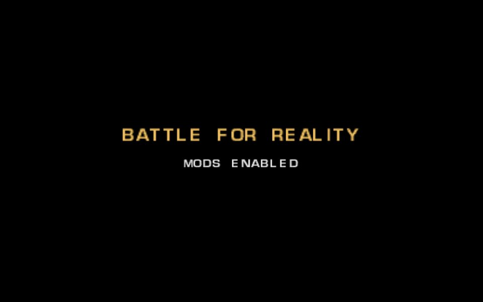

## Stages
**Where:** MULTIPLAYER > Split Screen > STAGE LIST, or Xbox Live > Create Match > LEVEL LIST. Each stage family is one row;
press **Left / Right** to pick the version (Lost / Light / Noble Palace, Sein / Edgar's Dream: Summit, Grand Panorama /
Sunset ...). The numbers after a name show which version you are on.

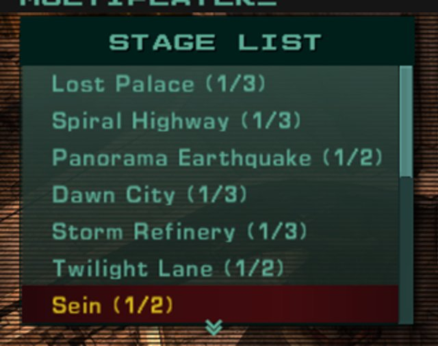

**The Summit** (STAGE LIST: Sein row, press Right twice): Sein's ground and the Summit as one stage.

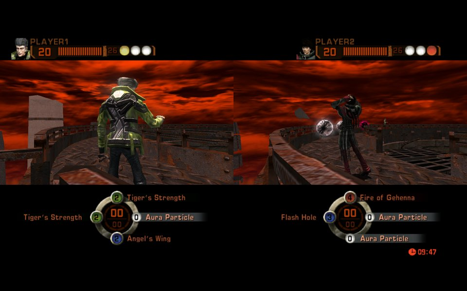

## Lobby: BFR Options
**Where:** the lobby (Split Screen or Xbox Live > Create Match) > X (OPTIONS) > BFR Options. Teammate Lock-on (each player's
own), Next Map, Tiebreaker, HUD Preset, Downed Glow, HUD Faces (the host's switches).

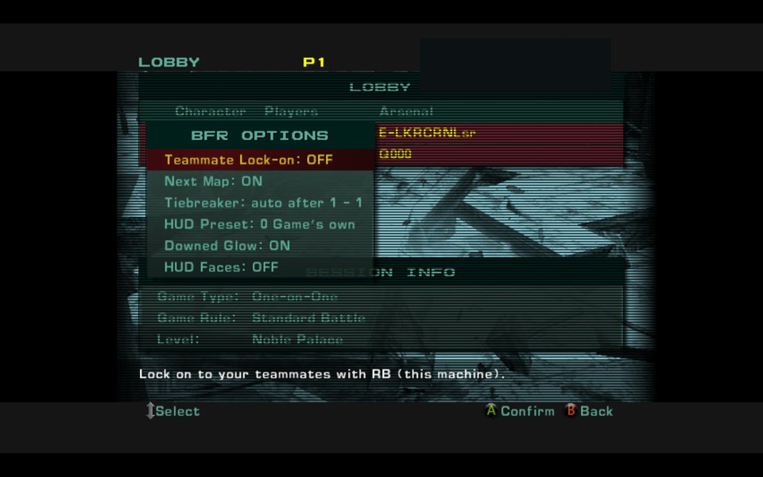 *(MODS edition)*

## Character select
**Where:** any character select. New faces for every player; X shows the monster page; COLORS lists the 15 outfits by name.

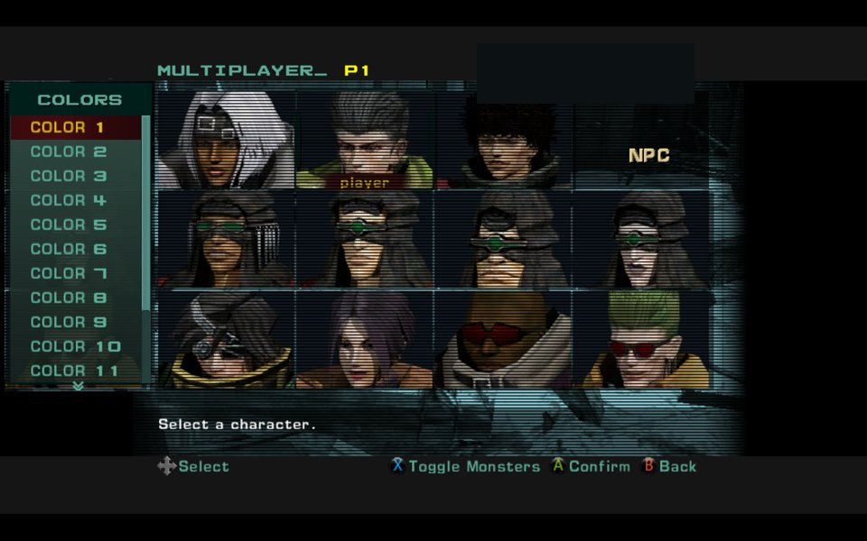

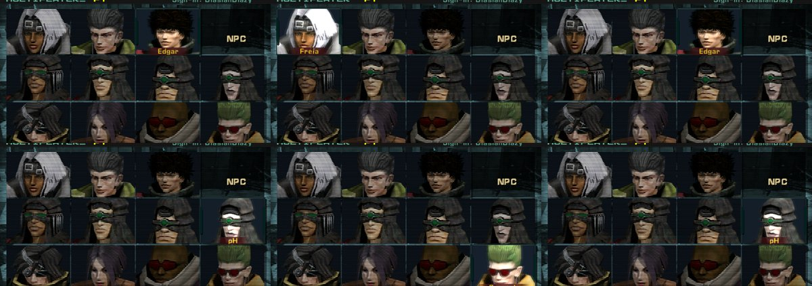

## HUD faces
**Where:** in a match (switch: BFR Options > HUD Faces). Each fighter's face beside their name and life bar, hurt at low life.

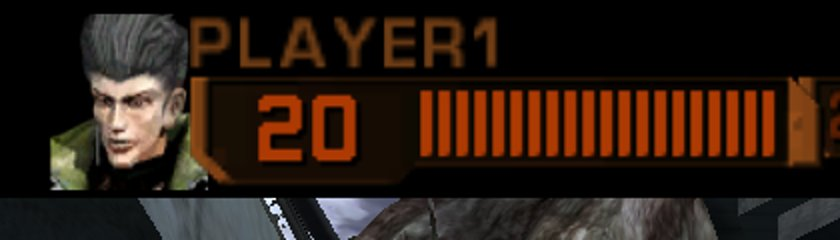

## 3 vs 3
**Where:** MULTIPLAYER > Split Screen > 3 VS 3 LOBBY. Six fighters, HUD for fighters 5 and 6.

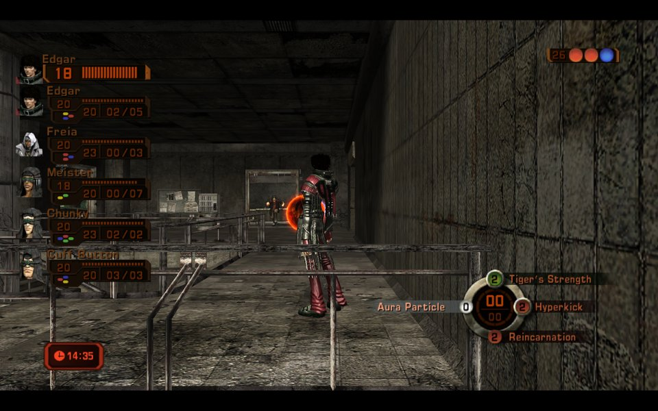

## Single Play
**Where:** MULTIPLAYER > Single Play (offline). You and CPU fighters: 1 vs 1, Tag Team, 3 vs 3, Battle Royale, Boss Raid.

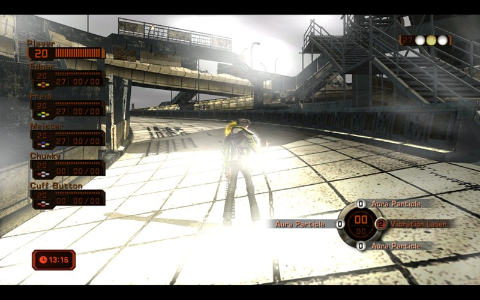

## Stock, Skill Vault
**Where:** Lab > View Stock List (Y sorts). Lab > View Skill Vault (or Back + Y on View Stock): swap a skill you don't own into
your stock.

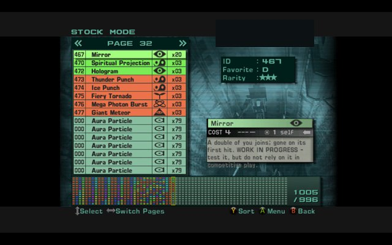 *(MODS edition)*

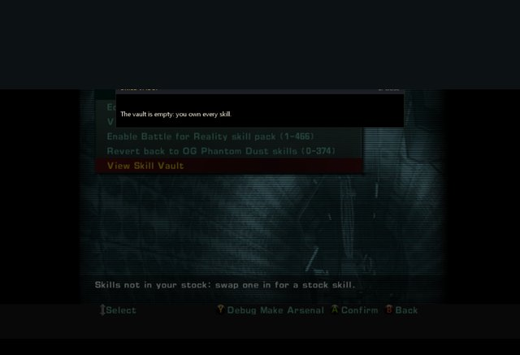 *(MODS edition)*

## Effect Lab
**Where:** Lab > Effect Lab (outside a match). Every skill's effect playing on a real stage, with the skill panel.

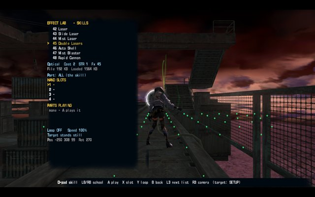 *(MODS edition)*

## MOD LIST
**Where:** main menu > MOD LIST. Every installed mod and what it does, What's New, and the shout-outs.

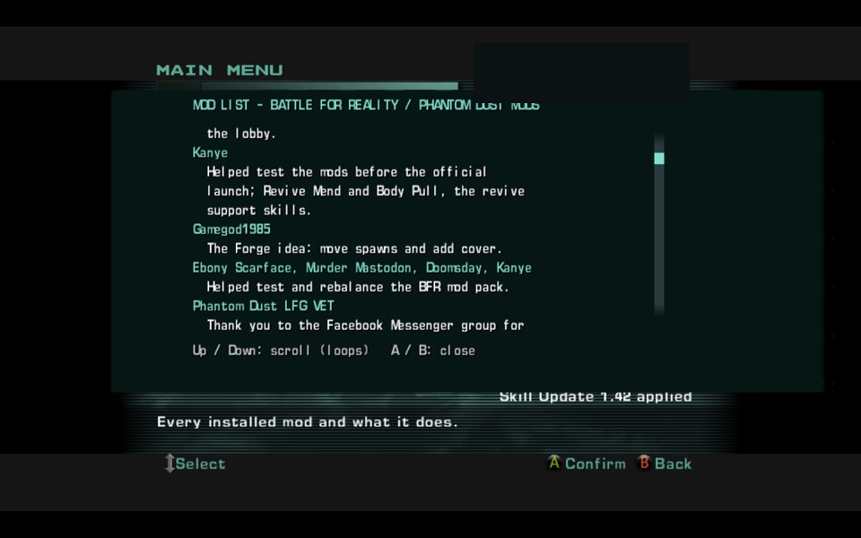

## Pictures still to come
These are in the pack and described in the main README; their screenshots are added after the next test session:
Battle for Reality skill switch (Lab), Xbox Live LEVEL LIST variants, Change Rule / Change Game Type, BFR rules (Most KOs,
First to 5 KOs, Survival, King of the Hill, Shrinking Arena, Aura Rush, Sudden Death, Realistic Collision), Tiebreaker vote,
Next Map, Download Battle line-ups, HUD presets (OPTIONS > HUD Preset), Downed Glow, intro and victory poses, Visions, holiday
themes, Create an Outfit and the other CREATE pages, FEEDBACK, Records, Stage Music, the pause menu's Teammate Lock-on row,
arsenal lists and Arsenal Data, Community skills.
